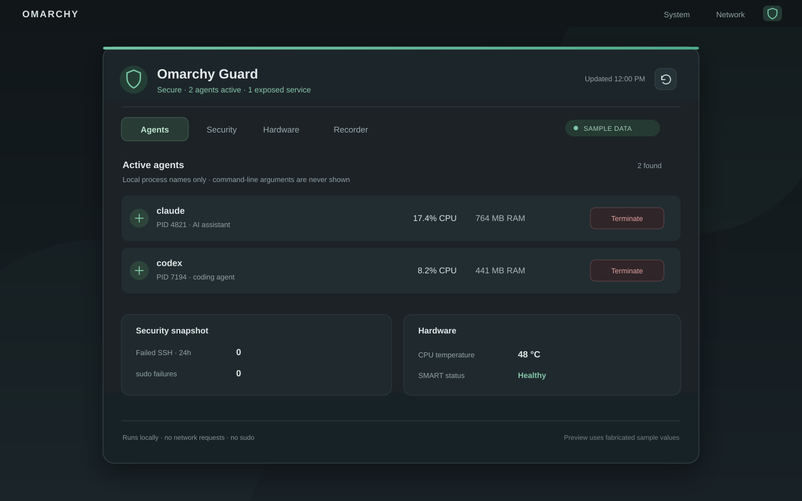
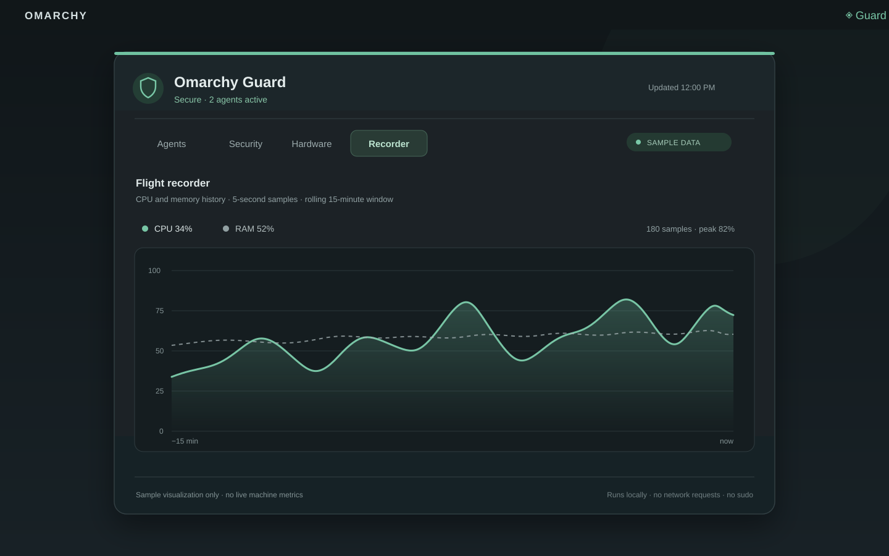

# Omarchy Guard

Omarchy Guard is a local Omarchy bar widget and popup for AI-agent activity,
security signals, hardware health, and a short CPU/RAM flight recorder.

## Features

- Flags active `claude`, `codex`, `opencode`, `gemini`, and `ollama` processes.
- Summarizes failed SSH and sudo events, and listening ports.
- Reports CPU temperature, battery wear, and SMART status when readable.
- Keeps up to 15 minutes of CPU and memory samples while the panel is open.
- Uses an optional guarded terminate action for detected agent processes.

## Requirements

- Omarchy with plugin support and Quickshell.
- Bash, `jq`, `ps`, `ss`, and `journalctl` for the corresponding probes.
- `smartctl` and permission to read SMART data for disk health.
- A Nerd Font containing the shield and panel glyphs.

Unavailable commands and restricted sources are shown as unavailable; Guard
does not invoke `sudo` or ask for credentials.

## Install

Once this plugin has been accepted into the Omarchy plugin marketplace, install
it with:

```sh
omarchy plugin add https://github.com/Aashutosh31/omarchy-guard.git --enable
```

For local development, link this checkout into the plugin directory:

```sh
mkdir -p "$HOME/.config/omarchy/plugins"
ln -s "$PWD" "$HOME/.config/omarchy/plugins/aashutosh31.guard"
omarchy plugin validate "$HOME/.config/omarchy/plugins/aashutosh31.guard"
```

Then enable `aashutosh31.guard` in the Omarchy bar plugin configuration and
reload the shell. The daemon is run directly by Quickshell; it does not start a
separate daemon process.

Remove it with:

```sh
omarchy plugin remove aashutosh31.guard
```

## Architecture and privacy

- `BarWidget.qml` polls `scripts/guard-daemon.sh --fast` asynchronously.
- `GuardPanel.qml` presents Agents, Security, Hardware, and Flight Recorder.
- `scripts/guard-daemon.sh` emits one bounded JSON snapshot. Security data and
  SMART probes are cached; private host addresses and MACs are redacted, and
  process command lines are not included in the JSON.
- `scripts/guard-kill.sh` accepts only a numeric PID and rechecks ownership,
  process identity, and the recognized-agent keyword before sending SIGKILL.
- The plugin never invokes `sudo`, reads no API credentials intentionally, and
  does not send data over the network.

The widget inspects local process names, listening sockets, journal counts,
thermal sensors, and battery metadata. Review the source and permissions before
installing if you have a stricter local threat model.

## Screenshots

The preview images show the UI with fabricated sample values, not a live
machine capture. They contain no real process IDs, host addresses, usernames,
or hardware readings.





## Development checks

```sh
python3 -m unittest discover -s tests -v
bash -n scripts/guard-daemon.sh
bash -n scripts/guard-kill.sh
omarchy plugin validate .
```

## Preview image

`preview.png` is a generic placeholder. Replace it with a real UI capture before
publishing, and sanitize the screenshot first: blur or remove usernames, local
IP addresses, terminal history, process names, and other machine-specific data.
